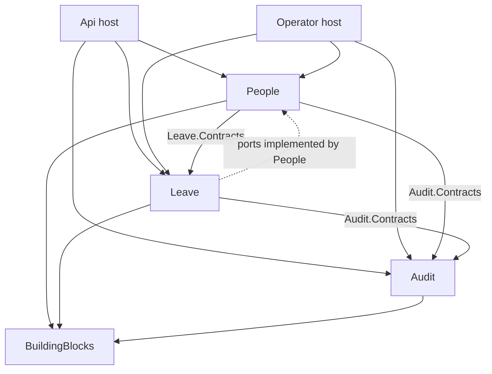
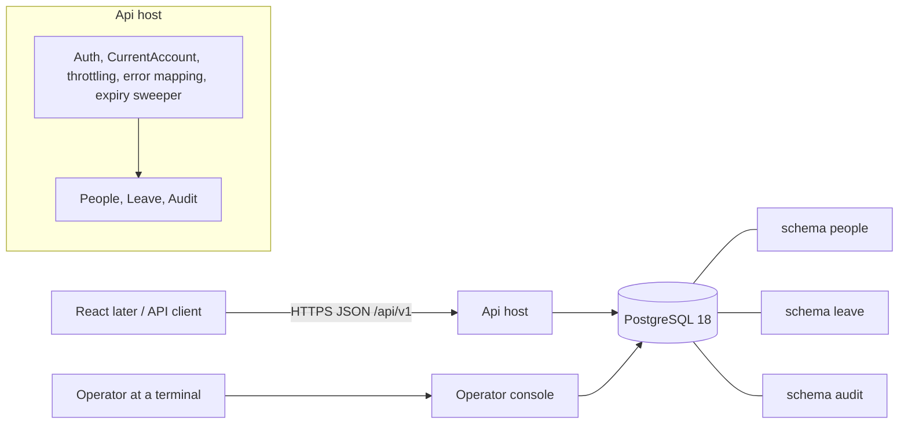
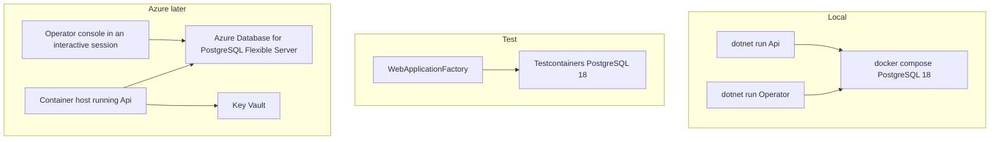
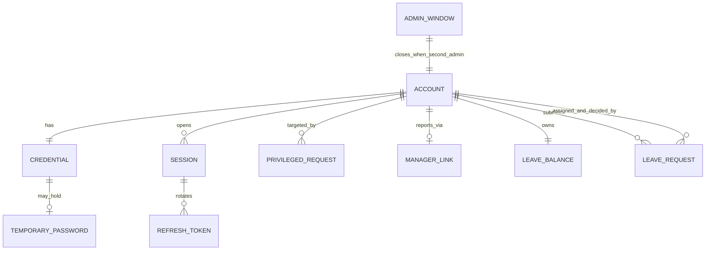

# Architecture Spine — Leave and Workforce Management API

## Design Paradigm

**Modular monolith, vertical slices, sized for a learning MVP.** One deployable ASP.NET Core process on .NET 10, split into three modules. A module is a bounded context: it owns its tables (one PostgreSQL schema, one `DbContext`), its rules and its endpoints. Each module is one project. Its public surface is the `X.Contracts` namespace; everything else is `internal`. Inside a module, code is organised by use case (a slice: endpoint, handler, validator), not by technical layer.

| Layer | Project | Owns |
| --- | --- | --- |
| Host | `LeaveWorkforce.Api` | Composition, auth pipeline, error mapping, throttling, OpenAPI, expiry sweeper |
| Host | `LeaveWorkforce.Operator` | Operator Operations console (no HTTP) |
| Module | `LeaveWorkforce.People` | Accounts, credentials, Temporary Passwords, sessions, tokens, throttling, Privileged Requests, Single-Administrator Window, manager links, and the use cases that span People and Leave |
| Module | `LeaveWorkforce.Leave` | Leave Requests, Leave Balances, review, history |
| Module | `LeaveWorkforce.Audit` | Audit Records, retention, later the hash chains |
| Shared | `LeaveWorkforce.BuildingBlocks` | Result/Error, ProblemDetails mapper, unit of work, advisory locks, paging |



Solid arrows mean "may depend on", and only the `Contracts` namespace of the target is visible. The dotted line is dependency inversion: `Leave` declares the ports it needs (who is the Direct Manager of whom, account names) in `Leave.Contracts`; `People` implements them and the host registers them. `Leave` never references `People`. Anything not drawn is forbidden.

## Invariants & Rules

### AD-1 — Module ownership and layering
- **Binds:** all
- **Prevents:** two modules owning one entity; circular module dependencies.
- **Rule:** Each entity and table belongs to exactly one module (People: Account, Credential, TemporaryPassword, Session, RefreshToken, PrivilegedRequest, AdminWindow, ManagerLink; Leave: LeaveBalance, LeaveRequest; Audit: AuditRecord, ChainAnchor). Dependency direction is People → Leave → Audit → BuildingBlocks, with the hosts on top. A use case that needs both People and Leave data lives in `People` and calls `Leave.Contracts`; `Leave` reaches People data only through its own ports. A new entity needs an owner named here or in a later AD.

### AD-2 — Contracts-only coupling
- **Binds:** all modules
- **Prevents:** reaching into another module's internals, shared EF models, cross-schema SQL.
- **Rule:** Each module is one project. Its public interfaces and DTOs live in the namespace `LeaveWorkforce.<Module>.Contracts`; every other type is `internal`. Other modules see only that namespace. The host-facing surface is part of it: each module's `Contracts` namespace holds a `<Module>Module` class (service registration and endpoint mapping) and an `IModuleMigrator`; `People.Contracts` also holds `ICurrentAccountReader` (for the `CurrentAccount` step), `IOperatorOperations` (bootstrap, issue-temp-password, recover-admin) and `IPrivilegedRequestExpiry` (for the sweeper); `Audit.Contracts` holds `IAuditRetention`. No cross-schema joins or foreign keys; reference another module's rows by id only. Architecture tests enforce the allowed project references, that only `Contracts` namespaces are public, and that no `DbContext` is used outside its module.

### AD-3 — One request, one transaction
- **Binds:** FR-3, FR-4, FR-5, FR-12, FR-14, FR-16, FR-19, FR-31, FR-25
- **Prevents:** half-applied cross-module effects; audit records missing or orphaned.
- **Rule:** Each HTTP request and each Operator Operation opens one database connection and one transaction through a request-scoped unit of work, shared by every module `DbContext` it touches (EF Core `UseTransactionAsync`). Cross-module effects the PRD requires to be atomic are synchronous calls on `Contracts` interfaces inside that transaction. There is no asynchronous messaging or outbox in the MVP. Transaction control is fixed in AD-22.

### AD-4 — Concurrency control and lock order
- **Binds:** SM-2, FR-3, FR-4, FR-5, FR-11, FR-12, FR-14, FR-15, FR-19, FR-27, FR-31, PRD §6
- **Prevents:** lost updates, deadlocks, overlapping or over-balance requests, cycles, zero Administrators, double bootstrap.
- **Rule:** Isolation is READ COMMITTED with explicit locks and a `lock_timeout` of 5 seconds (SQLSTATE 55P03 maps to 409). Every handler takes the locks it needs in one total order and never goes backwards: (1) advisory locks via `pg_advisory_xact_lock`, in the order administrator, then tree (bootstrap and the Single-Administrator Window run under the administrator lock); (2) Account rows in ascending id, with their session and refresh-token rows directly after; (3) LeaveBalance rows in ascending employee id, where the row is the per-Employee mutex for all submit, cancel, approve, reject, adjust and deactivate work; (4) LeaveRequest rows in ascending id; (5) the audit flush last (AD-12). The orchestrating handler takes advisory locks first through `IAdvisoryLocks`; calls it makes re-take them harmlessly. Any flow that can change the Administrator count takes the administrator lock unconditionally. Row locks use raw `SELECT … FOR UPDATE` inside the shared transaction, because EF Core 10 has no built-in support, and entities are loaded after the lock is held. A handler that needs an id it only knows from a row (approve, reject, cancel) reads it unlocked, locks in order, and re-verifies. `EnableRetryOnFailure` is off. Leave handlers cannot touch People tables, so Leave declares a port `IAccountState.LockAndGet(employeeId)` in `Leave.Contracts`, implemented by People, and calls it at step 2, before the balance lock, to lock and re-read the Account. Any flow that writes or relies on a manager link (create with a manager, reassign, clear, deactivate, reactivate) takes the tree lock and also locks the manager's Account row, so a manager cannot be deactivated while an Employee is being attached to them. Every state-changing handler re-validates Account state and the PRD preconditions after locking.

### AD-5 — Command handlers own all state changes
- **Binds:** all
- **Prevents:** business rules in endpoints; state changed through two code paths.
- **Rule:** Each use case is one handler in one slice: lock, validate, mutate, queue the Audit Record through `IAuditWriter`, save. Endpoints only bind input, call a handler and map the result. A query handler may use its module's `DbContext` with `AsNoTracking` and must not change business state; the only write a query may make is an Audit Record for an audited read (FR-13, FR-24, FR-26), inside a unit of work.

### AD-6 — Authentication, per-call account state and authorization
- **Binds:** SEC-3, SEC-7, SEC-8, SEC-10, SEC-12, SEC-13, SEC-24, FR-2, FR-21
- **Prevents:** trusting token claims; stale roles; open endpoints.
- **Rule:** JWT bearer with HS256, justified because the Api is the sole issuer and sole verifier; if any other service ever verifies tokens, switch to an asymmetric algorithm. Tokens are minted with `Microsoft.IdentityModel.JsonWebTokens` (`JsonWebTokenHandler`). Validation pins `ValidAlgorithms` to HS256, sets `MapInboundClaims = false`, validates issuer and audience, resolves the key by `kid` from a list of accepted keys (256-bit, from configuration or a secret store), lifetime 15 minutes, skew 30 seconds. Claims are `sub`, `sid` and `jti` only; no role claims. A `CurrentAccount` step runs before the handler and reads from the database: Account active, Administrator role, password state, session validity and whether the session is a Must-Change Session. Because that read is outside the handler's transaction, every state-changing handler re-locks the Account and re-validates it inside its own transaction (AD-4). `FallbackPolicy` requires an authenticated user; only login, refresh and health opt out. Each endpoint declares a named policy (`Authenticated`, `Administrator`, `MustChangeAllowed`). Relationship checks (owner, Direct Manager, Decider) are made inside handlers from current data.

### AD-7 — Error and response-code mapping
- **Binds:** SEC-11, SEC-14, SEC-16, PRD §6 API quality
- **Prevents:** inconsistent status codes; validation leaking resource existence.
- **Rule:** Handlers return `Result` with an error kind (Unauthenticated, Throttled, Forbidden, NotFound, Validation, Conflict). One mapper converts these to RFC 9457 ProblemDetails with a stable `code` extension and the status codes of SEC-11. Evaluation order inside a handler is entitlement (404 or 403), then field validation (400), then business rules and races (409). Request bodies bind to permissive DTOs and fields are validated inside the handler; automatic model-state 400 responses are disabled. A race loser is answered from the committed state (409 if still entitled, otherwise the 403 or 404 that applies). Error bodies never carry stack traces, SQL or internal ids.

### AD-8 — Passwords, Temporary Passwords and credentials
- **Binds:** SEC-1, SEC-2, SEC-22, FR-2, FR-7, FR-10, FR-28, FR-29, FR-30
- **Prevents:** plaintext or reversible secrets; temp-password dead ends; hasher lock-in.
- **Rule:** Hashing sits behind `IPasswordHasher`, implemented with Argon2id through `Konscious.Security.Cryptography.Argon2`, stored as a PHC-style string, defaults m=19456 KiB, t=2, p=1, configurable. Password length 12 to 128 is checked before hashing, and common passwords are rejected against a bundled offline top-10,000 list (source confirmed at scaffold). Temporary Passwords are 160 bits from `RandomNumberGenerator`, base32-encoded, stored hashed, valid 24 hours and one login. Password state lives on the Credential: `AwaitingPassword` (possibly with a live Temporary Password) or `HasPassword`. Issuing, reset, deactivation and reactivation void a live Temporary Password. A Must-Change Session is a `Session` row with `must_change = true` and has no refresh token. An unknown email takes a dummy verification path of equal cost.

### AD-9 — Sessions and refresh tokens
- **Binds:** SEC-4, SEC-6, SEC-24, FR-8, FR-9
- **Prevents:** token forks; sessions that outlive logout, reset or deactivation.
- **Rule:** Refresh tokens are opaque 256-bit random values; only the SHA-256 hash is stored, with a family id. Every refresh rotates. Reuse of a spent token revokes the family and its session. For 10 seconds after a rotation, a repeat of the spent token returns the same successor pair from a bounded in-process cache (raw pair, 10-second TTL); the cache is single-instance and is replaced by a distributed cache only when the app scales out. Idle expiry 7 days, absolute 30 days. Logout, password change, reset and deactivation end sessions; the per-call check in AD-6 rejects their Access Tokens at once.

### AD-10 — Throttling
- **Binds:** SEC-5, FR-7, FR-8, FR-10
- **Prevents:** targeted lockout; header-spoofing bypass; unbounded state.
- **Rule:** Per-account back-off (failure count, `backoff_until`, last failure) is stored on the Credential row and never evicted. Per-source limits use the ASP.NET Core rate limiter partitioned by connection address; forwarded headers are honoured only from configured known proxies. Unknown-email and global ceilings use a bounded in-memory store with TTL. All refusals return the same 429 for known and unknown emails. Numeric values come from options (defaults in PRD SEC-5). The in-memory parts assume one instance; a distributed store is deferred. Back-off counters persist even when the request fails (AD-22).

### AD-11 — Privileged Requests and the Single-Administrator Window
- **Binds:** FR-5, FR-27, FR-31, SM-6
- **Prevents:** a lone Administrator granting the role after the window; reopening the window; unexpirable requests.
- **Rule:** The window is a one-row `people.admin_window` table with a one-way `closed` flag, set in the same transaction that makes a second Administrator exist, under the administrator advisory lock. Direct create-with-flag and direct grant are allowed only while `closed = false`, otherwise 403. A Privileged Request grants the role to an existing active Account; approval re-checks Initiator, Approver and target inside the transaction. Expiry (24 hours) is evaluated on read and again at approval, so an expired request is never executable, and an Api hosted service sweeps expired requests every minute through a People handler with the System actor and writes the Expired Security-Class event.

### AD-12 — Audit writing and tamper evidence
- **Binds:** FR-25, FR-26, FR-32, SEC-19, SEC-23, SM-4
- **Prevents:** unaudited changes; edited history; a purge that breaks verification; lock contention.
- **Rule:** Only `IAuditWriter` (`Audit.Contracts`) writes Audit Records, inside the business transaction. `Write` only enqueues the record; the pipeline flushes the queue just before commit (also for `CommitOnFailure` flows), so audit locks are last and held briefly, and a failed flush fails the change. Events come from a closed catalogue `AuditActions` in `Audit.Contracts` that fixes each action's class (Ordinary or Security-Class); a caller cannot choose the class. The actor is an `Actor` value: `Account(id)`, `Operator(os user, host, label)` or `System(name)`. Each command writes its own events. Records carry a `class` column and a `seq` assigned as the previous `seq` of that class plus one under a per-class advisory lock (not a database sequence, so rollbacks leave no gaps, and not a row lock, because `app_rw` has no UPDATE privilege); the Ordinary lock is taken before the Security lock. The audit log is insert-only, so a failed-login aggregate is not updated: one record is written for the first failure per source per window and one for each lockout transition. Audit rows never contain passwords, Temporary Passwords, tokens or token hashes. **Tamper evidence:** two independent hash chains, one per class. Every record stores `prev_hash` and `hash = SHA-256(canonical record bytes || prev_hash)` from increment 1b, so no record is ever written without one. Canonical bytes are the UTF-8 JSON, keys sorted, of `seq`, `class`, `action`, `actor`, `target`, `at`, `before` and `after`; the first record of a chain uses 32 zero bytes as `prev_hash`. Anchors, purge and `verify-audit` are built in increment 7: purge deletes only whole old prefixes of a chain, never the head record, and writes a `ChainAnchor` with the last purged hash and seq; `verify-audit` recomputes from the anchor. Until then the database role in AD-13 and insert-only audit protect the records.

### AD-13 — Database roles and migrations
- **Binds:** SEC-23, FR-32
- **Prevents:** the application deleting audit data; migrations running with runtime privileges.
- **Rule:** Three roles, defined in `deploy/db/roles.sql`: `migrator` (DDL and extensions, used only by the Operator `migrate` command), `app_rw` (DML on the `people` and `leave` schemas; INSERT and SELECT only on `audit`; used by the Api and by every Operator command except `migrate` and `purge-audit`) and `retention_job` (SELECT and DELETE on the audit record tables, INSERT on `chain_anchors` and on the Security-Class record table for the purge summary; used only by `purge-audit`). Each process reads its connection string from secrets. Migrations are EF Core migrations per module `DbContext`, each with its own history table in its own schema, applied only through the Operator, never at API start-up.

### AD-14 — Operator Operations are a separate host
- **Binds:** FR-27, FR-29, FR-30, FR-32, SEC-22
- **Prevents:** operator functions reachable over HTTP; secrets in logs; DbContext bypass of the contracts.
- **Rule:** `LeaveWorkforce.Operator` is a console project with subcommands `migrate`, `bootstrap`, `issue-temp-password`, `recover-admin`, `purge-audit` and `verify-audit`. It exposes no HTTP and is not referenced by the API. It acts only through public `Contracts` and `People` handlers, never through a `DbContext`. `Audit.Contracts` exposes `IAuditRetention` (`Purge`, `Verify`) for it. The operator is identified by OS user plus host name plus an optional `--operator` label, recorded as the audit actor. `recover-admin` requires `--reason` (at most 500 characters); `issue-temp-password` requires an interactive "recipient verified" confirmation that is recorded. `bootstrap` and `issue-temp-password` refuse to run unless standard output is an interactive terminal (checked through an `IInteractiveTerminal` seam so tests can fake it), so a platform cannot capture the password in logs. A Temporary Password is written once to standard output directly, only after the transaction has committed, and never passed to `ILogger`, audit or exceptions; the Operator's password-issuing commands are never retried automatically.

### AD-15 — Configuration and Operator-controlled settings
- **Binds:** FR-32, SEC-3, SEC-5, SEC-15, PRD §6 Time and Retention
- **Prevents:** unvalidated or runtime-changeable policy; secrets in source.
- **Rule:** Strongly typed options with `ValidateOnStart`: Company Time Zone (valid IANA id), Ordinary and Security retention (ordinary at least 30 days, security longer than ordinary), JWT keys, throttle, Argon2 parameters, CORS origins. No API changes any of them. At start-up the effective values and any change from the last recorded values are written as a Security-Class Audit Record with actor `System("operator configuration")` by a start-up service in the Api host through `IAuditWriter`. Secrets come only from environment variables, user-secrets or Key Vault. The container image carries `tzdata` and does not enable invariant globalization.

### AD-16 — Time and dates
- **Binds:** FR-14, FR-15, FR-19, PRD §6 Time
- **Prevents:** time-zone drift; off-by-one working-day logic.
- **Rule:** All time comes from an injected `TimeProvider`; Today is the date in the Company Time Zone. Leave dates are `DateOnly` stored as `date` and accepted only as `yyyy-MM-dd`. Timestamps are `timestamptz` in UTC and serialised as ISO 8601 with `Z`. Working-day counting lives in one pure domain service (`WorkingDays`) with no clock or time-zone dependency, using calendar dates only. A LeaveRequest stores `first_working_day` and `last_working_day` alongside its start and end dates.

### AD-17 — Identifiers and data conventions
- **Binds:** SEC-18, FR-1, all tables
- **Prevents:** guessable ids; inconsistent keys.
- **Rule:** External identifiers are random UUID v4 (`Guid.NewGuid()`), generated in the application, never v7 and never database sequences. Table and column names are `snake_case`; each module's tables live in its own schema (`people`, `leave`, `audit`). Enumerations are stored as text with a `CHECK` constraint. Emails are stored with a normalised column and a unique index on it.

### AD-18 — API surface and hardening conventions
- **Binds:** PRD §6 API quality, SEC-15, SEC-17
- **Prevents:** ad-hoc routes, paging and error shapes; missing transport hardening.
- **Rule:** Routes are `/api/v1/...`, minimal APIs grouped per module, each module exposing one `MapXEndpoints` method. JSON is camelCase. Lists take `page` and `pageSize` (default 25, maximum 100) and return `{ items, total }`. Failures use ProblemDetails (AD-7). The OpenAPI document comes from `Microsoft.AspNetCore.OpenApi`, is emitted at build through `Microsoft.Extensions.ApiDescription.Server` as a build artifact, and is disabled or authenticated at run time outside Development. The Api host sets HTTPS redirection and HSTS, the OWASP secure response headers, and a CORS policy restricted to configured origins. The health endpoint returns only up or down.

### AD-19 — Logging, privacy and secrets
- **Binds:** SEC-16, SEC-20, SEC-21, SEC-22
- **Prevents:** personal data and secrets in logs; logs standing in for audit.
- **Rule:** Structured JSON console logging through `ILogger`. Log messages carry ids and error codes only, never names, emails, tokens or passwords. Secret-bearing types override `ToString` to a placeholder. Data exposure follows entitlement checks in handlers (SEC-9, SEC-10, FR-13). Logs are operational only and never a source of audit truth.

### AD-20 — Test and delivery gates
- **Binds:** SM-1 to SM-9, PRD §6 Testability
- **Prevents:** increments shipping without the PRD's safety tests.
- **Rule:** Tests use xunit.v3, `Microsoft.AspNetCore.Mvc.Testing` and Testcontainers PostgreSQL 18, in three projects: `Architecture.Tests`, `Api.IntegrationTests` (HTTP tests plus domain unit tests) and `Concurrency.Tests`. Each increment adds integration tests for its endpoints and the authorization matrix cases it introduces (SM-3). Architecture tests run from the first increment. The concurrency project covers the races in PRD §6 and asserts the SM-2 invariants with database queries. No increment starts until the previous one is green.

### AD-21 — Account mutation paths and creation
- **Binds:** FR-1, FR-4, FR-5, FR-6, FR-27, FR-28, FR-29, FR-31, SM-2
- **Prevents:** several code paths changing Account state; duplicated last-Administrator logic; bootstrapped Administrators with no balance.
- **Rule:** Every change to Account, Credential, session, role and manager-link state goes through one internal account service inside `People`; the last-Administrator check, the administrator advisory lock and the window logic live there and nowhere else. `People` is the only creator of Accounts, including the first Administrator (the Operator `bootstrap` calls the same People handler), and every creation also calls `Leave.InitialiseBalance` (Total 0) and, when a manager is given, stores the manager link. `Leave` never creates a balance lazily; a missing balance is an internal error. The cross-module use cases (create, deactivate, reactivate, assign, reassign, clear manager, ordinary password reset, manager-joined account list) are `People` handlers that call `Leave.Contracts`. Nothing outside `People` touches its `DbContext`.

### AD-22 — Transaction policy
- **Binds:** FR-8, FR-25, FR-27, FR-29, SEC-5, SM-4
- **Prevents:** unclear commit and rollback behaviour; lost security state on failure; double commits.
- **Rule:** The request pipeline, not the handler, begins and commits the unit of work. Handlers call `SaveChanges` per `DbContext` but never commit; contract calls join the ambient unit of work and never open savepoints. Any failure `Result` rolls back, except for a closed list of flows that set `CommitOnFailure`: failed-login back-off and its aggregate audit record, refresh-token reuse revocation, and audited Operator refusals (FR-27, FR-29). On SQLSTATE 23505, 23P01 (exclusion violation), 40001, 40P01 or 55P03 the whole HTTP handler is re-run once in a fresh unit of work, then answered as 409. Operator commands are not auto-retried. No other retry exists.

### AD-23 — Database-level invariants
- **Binds:** SM-2, FR-3, FR-11, FR-12, FR-14, FR-15, FR-31, PRD §6
- **Prevents:** invariants held only by application code that a second writer can break.
- **Rule:** Constraints: `leave_balances` has `total >= 0`, `reserved >= 0`, `reserved <= total`. `leave_requests` has an exclusion constraint `EXCLUDE USING gist (employee_id WITH =, daterange(first_working_day, last_working_day, '[]') WITH &&) WHERE (status IN ('Pending','Approved'))` (extension `btree_gist`, created by `migrator`), so overlap is judged on working days and cannot be bypassed. `manager_links` has a unique `employee_id` and `CHECK (employee_id <> manager_id)`. `privileged_requests` has `CHECK (initiator_id <> approver_id AND target_id <> initiator_id AND target_id <> approver_id)`. Accounts have a unique normalised email. Rules the database cannot express stay in handlers and are verified by the SM-2 invariant queries: no reporting cycle, every active Employee's Direct Manager active or absent, `reserved` equal to the sum of Pending requested days, and at least one active Administrator.

### AD-24 — Leave side-effect contracts and manager assignment
- **Binds:** FR-3, FR-4, FR-19, FR-21, FR-23
- **Prevents:** two sources of truth for the manager; ambiguous cancel and move semantics.
- **Rule:** `People.ManagerLink` is the source of truth for who manages whom. A LeaveRequest stores `assigned_manager_id` and, once decided, `decider_id`. `Leave.Contracts` exposes `ILeaveCommands` with `InitialiseBalance(employeeId)`, `MovePending(employeeId, newManagerId)`, which only updates `assigned_manager_id` on Pending requests, and `CancelPendingFor(employeeId, reason, actor)`, which cancels every Pending request, decrements Reserved, records the reason and actor, and queues `leave_request.cancelled` per request. It also declares the ports `IRelationshipDirectory` (current Direct Manager of an Employee, Direct Reports of a Manager) and `IAccountNames` (batched names), which `People` implements. Deciding and cancelling re-read the manager relationship through these ports inside the transaction.

### AD-25 — Operational envelope
- **Binds:** SEC-15, FR-29, FR-30, PRD §6 Portability
- **Prevents:** environment drift; secrets reaching platform logs; missing runbooks.
- **Rule:** Environments are Development, Test and Production, differing only by environment variables and secrets. Locally, Kestrel uses the .NET dev certificate; in Production TLS terminates at the hosting platform with HTTPS redirection and HSTS. Provisioning order is `roles.sql`, then `migrate`, then `bootstrap`, then `issue-temp-password`. In the MVP the Operator runs `purge-audit` and `verify-audit` by hand on a documented cadence (monthly); a scheduled Azure job is deferred. The Operator runbook `docs/operator-runbook.md`, which holds the FR-29 recovery procedure, is a deliverable of increment 1b. Database backup and restore are the managed database service's job once on Azure and are not designed here.

## Consistency Conventions

| Concern | Convention |
| --- | --- |
| Naming | Slices `Features/<UseCase>/{Endpoint,Handler,Validator,Request,Response}.cs`; public interfaces in `LeaveWorkforce.<Module>.Contracts` named `I<Capability>`; audit actions from the closed `AuditActions` catalogue, `snake.case` like `leave_request.approved` |
| Data & formats | UUID v4 ids, `DateOnly` and `timestamptz` per AD-16, whole-number days, snake_case schema, ProblemDetails with `code`, lists `{ items, total }` |
| Authorization | Policy on every endpoint plus relationship checks in the handler; never a role claim; `CurrentAccount` per call and re-validation after locking |
| State & cross-cutting | One handler per use case, one transaction owned by the pipeline, audit queued and flushed last, locks in AD-4 order, `Result` not exceptions for expected outcomes |
| Errors | Entitlement, then validation, then business rules (AD-7); 409 for lost races |
| Config | Options validated on start; secrets only from env, user-secrets or Key Vault |
| Logging | Ids and codes only; no personal data, tokens or passwords |
| Tests | Real PostgreSQL via Testcontainers; no in-memory EF provider; SM-2 invariants checked by database queries |

## Stack

| Name | Version |
| --- | --- |
| .NET (SDK and runtime, LTS) | 10.0.x (`global.json` SDK 10.0.103, `rollForward: latestPatch`) |
| ASP.NET Core (minimal APIs, built-in rate limiting and OpenAPI) | 10.0.x |
| Entity Framework Core | 10.0.x (at least 10.0.4) |
| Npgsql.EntityFrameworkCore.PostgreSQL | 10.0.3 |
| PostgreSQL | 18 (18.6 at authoring); Docker image `postgres:18` |
| Microsoft.AspNetCore.Authentication.JwtBearer | 10.0.x |
| Microsoft.IdentityModel.JsonWebTokens | current 8.x at scaffold |
| Konscious.Security.Cryptography.Argon2 | 1.3.1 |
| Microsoft.Extensions.ApiDescription.Server | 10.0.x |
| xunit.v3 | 4.0.2 |
| Microsoft.AspNetCore.Mvc.Testing | 10.0.x |
| Testcontainers.PostgreSql | 4.15.0 |
| Docker (local PostgreSQL and tests) | 27.x |
| Solution format | .slnx (default of `dotnet new sln` on .NET 10) |

## Structural Seed







`ACCOUNT` through `MANAGER_LINK` belong to People; `LEAVE_*` belong to Leave. Leave rows reference accounts by id only, never a foreign key. Audit records are in the `audit` schema (two class tables and `chain_anchors`) and reference accounts by id only.

```text
leave-workforce-api/
  LeaveWorkforce.slnx
  global.json                # pins the .NET 10 SDK, rollForward latestPatch
  Directory.Build.props      # nullable, warnings as errors, analyzers
  Directory.Packages.props   # central package versions
  compose.yaml               # local PostgreSQL 18
  deploy/db/roles.sql        # migrator, app_rw, retention_job
  docs/operator-runbook.md   # FR-29 recovery procedure and issuance procedure
  src/
    BuildingBlocks/          # Result/Error, ProblemDetails, UnitOfWork, IAdvisoryLocks, Paging
    People/                  # module (Contracts namespace public, rest internal)
    Leave/                   # module
    Audit/                   # module
    Api/                     # host
    Operator/                # console host
  tests/
    Architecture.Tests/  Api.IntegrationTests/  Concurrency.Tests/
```

A fuller module map and file-level proposal are in the companion `solution-structure.md`.

## Capability → Architecture Map

| Capability / Area | Lives in | Governed by |
| --- | --- | --- |
| FR-1 Create Account, FR-6 list Accounts | People (sole creator; calls `Leave.InitialiseBalance`) | AD-1, AD-3, AD-21 |
| FR-2, FR-7 to FR-10 login, first login, refresh, logout, change password | People | AD-6, AD-8, AD-9, AD-10, AD-22 |
| FR-3 Direct Manager assign, reassign, clear | People (moves or cancels requests via `Leave.Contracts`) | AD-3, AD-4, AD-24 |
| FR-4 Deactivate, reactivate | People (calls `Leave.CancelPendingFor`) | AD-3, AD-4, AD-21, AD-24 |
| FR-5, FR-31 Administrator role, Privileged Requests, window | People | AD-4, AD-11, AD-21, AD-23 |
| FR-11 to FR-13 balance | Leave | AD-4, AD-5, AD-23 |
| FR-14 to FR-17 submit, overlap, cancel, track | Leave | AD-4, AD-5, AD-16, AD-23 |
| FR-18 to FR-21 manager review and authority | Leave (relationships via its ports) | AD-6, AD-7, AD-24 |
| FR-22 to FR-24 history and visibility | Leave | AD-5, AD-6, AD-7 |
| FR-25, FR-26 audit | Audit | AD-12, AD-13 |
| FR-27, FR-29, FR-30 Operator operations | Operator host through People handlers | AD-14, AD-21, AD-25 |
| FR-28 ordinary password reset | People | AD-8, AD-21 |
| FR-32 operator configuration | Api and Operator options, Audit | AD-15 |
| SEC-11 response codes | BuildingBlocks mapper | AD-7 |
| SEC-15, SEC-17 transport and headers | Api host | AD-18, AD-25 |
| SEC-9, SEC-20 isolation and privacy | handlers in each module | AD-6, AD-19 |
| SEC-23 audit protection | Audit, database roles | AD-12, AD-13 |

## Deferred

- **Audit purge, anchors and verification.** Designed in AD-12; the hashes are written from increment 1b, and `purge-audit`, anchors and `verify-audit` are built in increment 7.
- **Scale-out.** Distributed cache and throttle store (Redis or similar), and moving the refresh-grace cache out of process. The single-instance assumption holds until the app scales out.
- **Azure hosting.** Container Apps versus App Service, networking, Key Vault wiring, managed identity for database access, a scheduled job for audit purge and verification, immutable-blob anchoring of the audit chains, backup and restore policy.
- **Splitting People.** If Accounts and manager links need to scale or change independently, People can later split into Identity and Organisation behind the same `Contracts` namespaces.
- **Architecture-test library and naming mapping.** NetArchTest or ArchUnitNET, and a snake_case naming package versus explicit column mapping, chosen at scaffold.
- **Common-password list source.** The exact top-10,000 list and its licence, confirmed at scaffold.
- **React front end.** Token storage and CORS origins; only the contract (AD-18) is fixed here.
- **Exact numeric tuning.** Throttle ceilings, Argon2 cost on target hardware, pool sizes, lock timeouts under load and stress-test iteration counts are options values set at implementation.
- **CI and release pipeline.** Build, test and artifact publishing, beyond the gates in AD-20.
- **Observability beyond logs.** Metrics and tracing.
