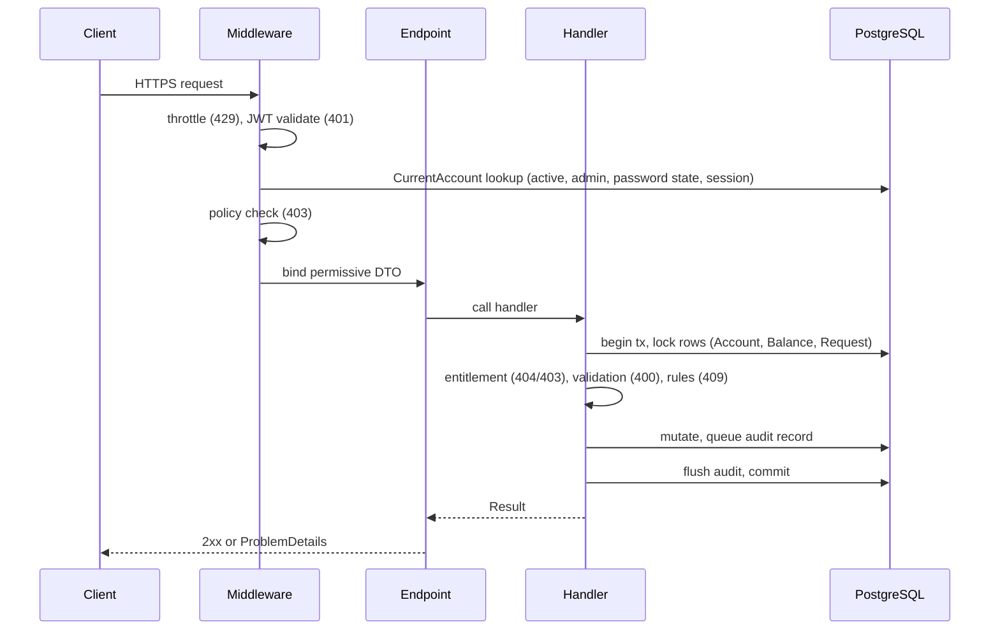
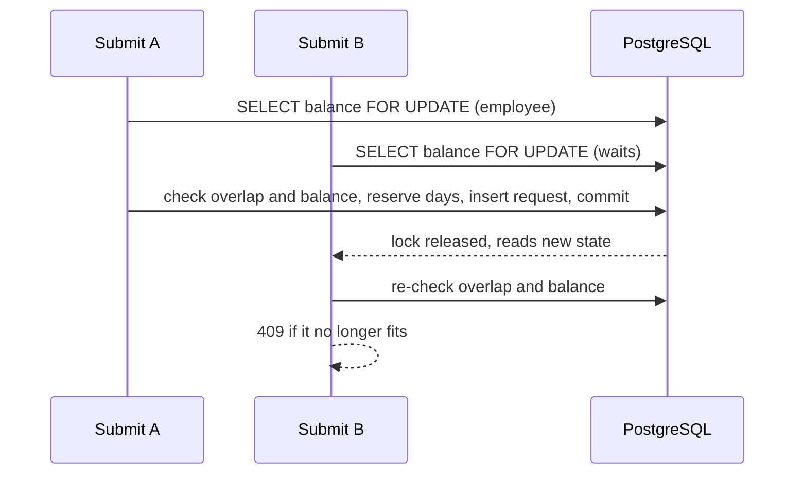

# Proposed solution structure — Leave and Workforce Management API

A human-readable view of the spine (`architecture-leave-workforce-api.md`). The spine's ADs bind; this file is a proposal the code will own once it exists. Nothing here has been generated. The shape is deliberately small: 6 source projects and 3 test projects.

## 1. Projects and what each owns

| Project | Type | Owns | Depends on |
| --- | --- | --- | --- |
| `BuildingBlocks` | class library | `Result`/`Error`, ProblemDetails mapper, `IUnitOfWork`, `IAdvisoryLocks`, paging | none |
| `Audit` | class library | `Audit.Contracts`: `IAuditWriter` (enqueue; the pipeline flushes before commit), `IAuditRetention` (`Purge`, `Verify`), `AuditActions` (closed catalogue fixing the event class), `Actor`. Internal: `AuditDbContext`, class tables, retention, later the hash chains | BuildingBlocks |
| `Leave` | class library | `Leave.Contracts`: `ILeaveCommands` (`InitialiseBalance`, `MovePending`, `CancelPendingFor`), ports `IRelationshipDirectory`, `IAccountNames` and `IAccountState` (`LockAndGet`), request and balance DTOs. Internal: `LeaveDbContext`, balances, requests, `WorkingDays`, review, history | BuildingBlocks, `Audit.Contracts` |
| `People` | class library | `People.Contracts`: the host-facing surface (`PeopleModule`, `IModuleMigrator`, `ICurrentAccountReader`, `IOperatorOperations`, `IPrivilegedRequestExpiry`). Internal: `PeopleDbContext`, accounts, credentials, `IPasswordHasher` (Argon2id), Temporary Passwords, sessions, tokens, throttling, Privileged Requests, window flag, manager links, the single account service, and the use cases that span People and Leave. Implements Leave's ports | BuildingBlocks, `Leave.Contracts`, `Audit.Contracts` |
| `Api` | ASP.NET Core web | Composition root, auth, `CurrentAccount` step, rate limiter, error mapping, endpoint mapping, OpenAPI, expiry sweeper, start-up config audit | People, Leave, Audit, BuildingBlocks |
| `Operator` | console | `migrate`, `bootstrap`, `issue-temp-password`, `recover-admin`, `purge-audit`, `verify-audit`; acts through public contracts and People handlers, never a `DbContext` | People, Leave, Audit, BuildingBlocks |

**Boundary rule.** Inside a module project, only the `LeaveWorkforce.<Module>.Contracts` namespace is `public`; everything else is `internal`. Another project that references a module sees only that namespace. Architecture tests check the reference graph, the `public` surface and that no `DbContext` is used outside its module.

## 2. Slices inside each module (vertical, one folder per use case)

```text
People/Features/
  Login/  Refresh/  Logout/  ChangePassword/
  CreateAccount/  ListAccounts/  ResetPassword/            # FR-1, FR-6, FR-28
  DeactivateAccount/  ReactivateAccount/                   # FR-4
  AssignManager/  ClearManager/  ListDirectReports/        # FR-3, FR-6
  GrantAdministrator/  RemoveAdministrator/                # FR-5
  CreatePrivilegedRequest/  ApprovePrivilegedRequest/  RejectPrivilegedRequest/
  ListPrivilegedRequests/  ExpirePrivilegedRequests/       # FR-31, called by the sweeper
  Operator/{Bootstrap,IssueTemporaryPassword,RecoverAdministrator}/   # FR-27, FR-29, FR-30
Leave/Features/
  Balance/{Set,Adjust,View}/
  Requests/{Submit,Cancel,Get,List}/
  Review/{ListForManager,Approve,Reject}/
  History/{Employee,Report,AdministratorView}/
Audit/Features/
  QueryAuditRecords/
```

Each folder holds the endpoint, handler, validator, request and response types for that use case. Domain types (aggregates, value objects, domain services such as `WorkingDays`) sit in a `Domain/` folder beside `Features/` and are `internal`.

## 3. Request pipeline



## 4. Cross-module flows (one transaction each, AD-3)

| Flow | Handler (in `People`) | Steps |
| --- | --- | --- |
| Create Account (FR-1, also bootstrap) | `CreateAccount` | administrator lock if the role flag is set; tree lock and manager Account lock if a manager is given → create Account and Credential (Awaiting Password) → optional manager link → `Leave.InitialiseBalance` → audit |
| Deactivate Account (FR-4) | `DeactivateAccount` | administrator lock, tree lock → lock Account → count active Direct Reports (409 if any) → `Leave.CancelPendingFor` → deactivate, check last Administrator, end sessions, void Temporary Password → audit |
| Clear manager (FR-3) | `ClearManager` | tree lock → lock Account → clear link → `Leave.CancelPendingFor` → audit |
| Reactivate Account (FR-4) | `ReactivateAccount` | tree lock → lock Account and its manager's Account → check manager active → back to Awaiting Password → audit |
| Reassign manager (FR-3) | `AssignManager` | tree lock → lock Account → cycle check → update link → `Leave.MovePending` → audit |
| Ordinary password reset (FR-28) | `ResetPassword` | lock Account → check the target is not the caller's Direct Manager → reset → audit |
| Approve a request (FR-19) | `Leave` only | `IAccountState.LockAndGet` (People adapter) → lock Balance → lock Request → relationship check through Leave's port → mutate → audit |

## 5. Leave-balance concurrency, in one picture



The balance row is the per-Employee mutex. A CHECK constraint on balances and an exclusion constraint on overlapping working days back it up, so a second writer cannot break the invariant even if the application code is wrong.

## 6. Database layout (one schema per module, ids only across schemas)

| Schema | Tables |
| --- | --- |
| `people` | `accounts`, `credentials`, `temporary_passwords`, `sessions`, `refresh_tokens`, `privileged_requests`, `admin_window`, `manager_links` |
| `leave` | `leave_balances`, `leave_requests` |
| `audit` | `audit_records_ordinary`, `audit_records_security`, `chain_anchors` (hash chains arrive in increment 7) |

Roles and grants are in `deploy/db/roles.sql` (AD-13): `migrator`, `app_rw`, `retention_job`.

## 7. Operator bootstrap and password issuance

1. The Operator runs `dotnet run --project src/Operator -- bootstrap` in an interactive terminal. It refuses if standard output is redirected.
2. It connects as `app_rw`, takes the administrator advisory lock, and checks that no Administrator exists. A repeat run is refused and audited.
3. It calls the same `CreateAccount` handler the API uses: an Administrator Account in the Awaiting Password state and a zero balance.
4. It generates a 160-bit random Temporary Password, stores only its Argon2id hash, and queues a Security-Class audit record naming the operator (OS user and host).
5. After the transaction commits, it prints the Temporary Password once. Nothing secret reaches a logger, an exception or an audit row.

`issue-temp-password` works the same way, with an interactive "recipient verified" confirmation that is recorded.

## 8. Proposed build increments (matches PRD §8.3)

1. **1a, walking skeleton.** `global.json`, `.slnx`, central packages, `BuildingBlocks`, an empty `Api` with a health endpoint, `compose.yaml`, `deploy/db/roles.sql`, the Testcontainers harness, `Architecture.Tests` and an empty `Concurrency.Tests` project with its harness. Done when an integration test starts PostgreSQL, calls health, and an architecture test passes.
2. **1b, first vertical slice.** `Audit` (insert-only, hashes written, start-up configuration audit per FR-32), `People` (accounts, credentials, sessions, tokens), `Leave.InitialiseBalance`, `Operator` (`migrate`, `bootstrap`, `issue-temp-password`, `recover-admin`), `docs/operator-runbook.md`. Slice: bootstrap, issue a temporary password, log in, change password, refresh, log out.
3. **2, administration.** Create and view Accounts, manager assign, reassign and clear, ordinary password reset, Privileged Requests, deactivate and reactivate (request side effects stubbed until increment 4).
4. **3, balance.** Set, adjust, view.
5. **4, requests.** Submit, overlap, cancel, track; complete the cancel and move side effects of increment 2.
6. **5, manager review.** List, approve, reject.
7. **6, history and visibility.**
8. **7, hardening.** Audit read endpoint, audited reads, `purge-audit`, anchors and `verify-audit`, and the concurrency stress tests against all PRD §6 races.

Next steps after the architecture is approved: `bmad-spec` to adopt the spine as a companion, then `bmad-ticket` to turn the increments into tickets. Scaffolding the .NET solution is a separate step, done one increment at a time.
